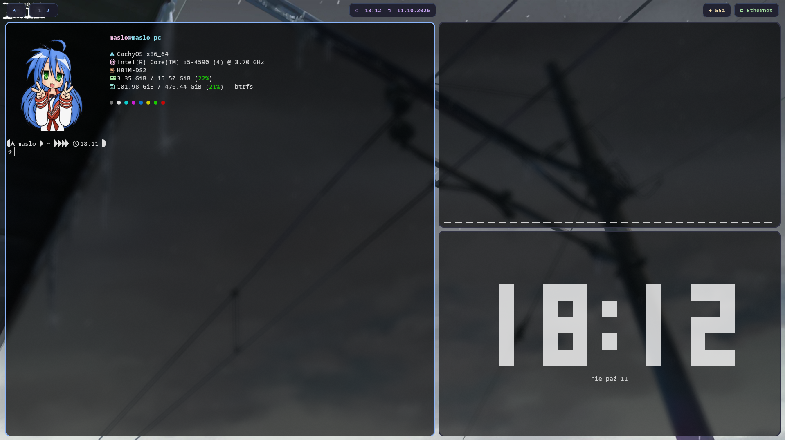
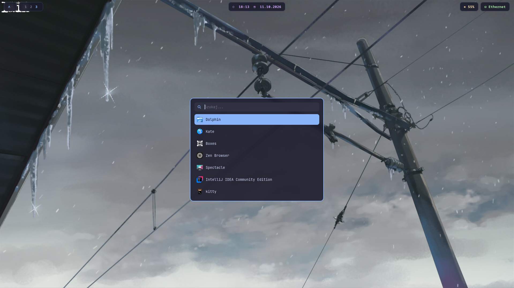
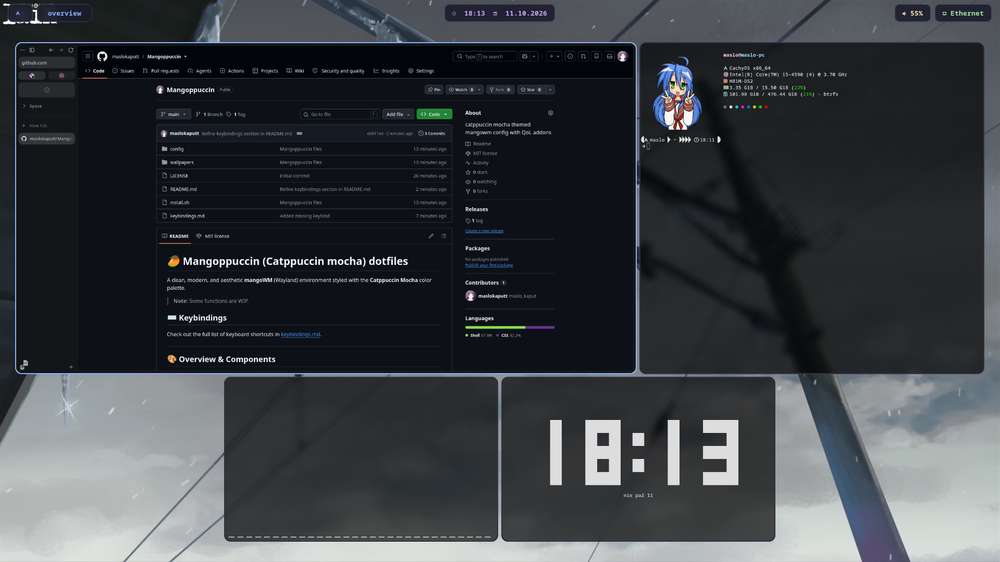

# 🥭 Mangoppuccin (Catppuccin Mocha) dotfiles

A clean, modern, and aesthetic **mangoWM** (Wayland) environment styled with the **Catppuccin Mocha** color palette.

> **Note:** Some functions are WIP.

## ⌨️ Keybindings

Check out the full list of keyboard shortcuts in [keybindings.md](keybindings.md).

---

## 🎨 Overview & Components

| Desktop | Rofi Menu | Overview |
| ------- | --------- | -------- |
| [](assets/asset.png) | [](assets/asset2.png) | [](assets/asset1.png) |

- **Window Manager:** `mangoWM`
- **Status Bar:** `Waybar` (Pill layout)
- **Application Launcher:** `Rofi` (Wayland)
- **Terminal:** `Kitty`
- **Lock Screen:** `Swaylock-effects`
- **System Fetch:** `Fastfetch`
- **Font:** `JetBrainsMono Nerd Font`
- **Icon Theme:** `Papirus`

---

## 🚀 Quick Start

Requires an **Arch-based** distro (uses `pacman` and the AUR). Run as a normal user, not root.

The script installs `git` and `yay` for you if they are missing.

> ⚠️ **Notice:** The script moves your existing `waybar`, `rofi`, `kitty`, `fastfetch`, `mangowm` and `swaylock` config folders to `~/.config-backup/mangoppuccin-<date>/` before copying the new ones. AUR packages are not auto-confirmed, so you can review their PKGBUILDs.

```bash
# 1. Clone the repository
git clone https://github.com/maslokaputt/Mangoppuccin.git
cd Mangoppuccin

# 2. Make the script executable and run it
chmod +x install.sh
./install.sh
```

---

## 🐟 Recommended Shell: Fish

For the smoothest terminal experience (fast auto-suggestions and clean syntax), Fish shell is recommended. The install script already installs `fish` and `starship`.

Set Fish as default:

```bash
# 1. Change default shell to Fish
chsh -s $(which fish)

# 2. Disable the welcome greeting
fish -c "set -U fish_greeting ''"
```

---

## 📄 License

MIT, see [LICENSE](LICENSE).
